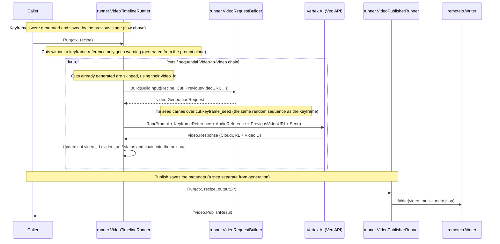

# 📂 Architecture

[← README](../README.md)

## Project structure

The architecture draws its boundary at **abstraction through ports (Hexagonal Architecture)**, so that a change of Veo API endpoint or a swap of the video synthesis engine is easy to make.

```text
go-veo-orchestrator/
├── video/       # [Domain model] Recipe / Cut / GenerationRequest / Response /
│                #   KeyframeImage / PublishResult. The bottom layer; depends on nothing.
├── ports/       # [Contracts] VideoRunner, each Prompt, ContentReader, the four Runner
│                #   interfaces, Workflows, Config, sentinel errors.
├── veo/         # [Veo constraints] mode classification (ClassifyRequest), allowed
│                #   durations per mode, cut-split planning. Makes no API calls.
├── internal/keyframe/  # [Image generation for one cut] only builds and sends the prompt.
├── runner/             # [Implementations] VideoScriptRunner / CutKeyframeRunner /
│                       #   VideoTimelineRunner (+ VideoRequestBuilder) / VideoPublisherRunner.
│                       #   Owns keyframe concurrency and saving.
└── workflow/    # [Integration] workflow.New assembles every Runner and returns Workflows.
                 #   Rate limiting, timeouts and singleflight live here too.
```

Dependencies run one way: `video → ports → veo → {internal/keyframe, runner} → workflow`. There are five public packages — `video` / `ports` / `veo` / `runner` / `workflow` — and only `keyframe` sits under `internal/`. `runner` was made public because the per-cut hooks (`WithRequestBuilder` / `WithCutGate` / `WithCutObserver`) were unreachable through `ports.VideoTimelineRunner`, which left consumers rewriting the generation loop themselves. The hooks are per-runner, so set them only on a runner the consumer built itself, never on a shared instance.


## 💾 Who generates and who saves

The destination is injected as a `remoteio.Writer`, so this library knows neither GCS nor S3. What it owns is not "where to save" but **its own format and naming rules**. On top of that, keyframes and video are deliberately treated differently.

| | Generate | Save |
| --- | --- | --- |
| Keyframes | `CutKeyframeRunner` | **The same Runner, each time one image is generated** (`GenerateAndSave` / `EditAndSave`) |
| Video | `VideoTimelineRunner.Run` | **Does not save.** The caller invokes `VideoPublishRunner` (`Workflows.Publish`) |

**Why the Runner owns keyframe saving**: the saved name `keyframe_<position in the recipe>.<extension>` (the extension comes from the generated image's MIME type) is tied to the order of the cuts. Handing it to the caller would make the caller reimplement the position-to-filename mapping and the setting of `keyframe_reference`, inviting accidents where `keyframe_1.png` points at a different cut during a partial generation.

**Why each image is saved on its own**: if images are generated as a batch and saved afterwards, a process dying in between (Cloud Run timeout, deploy, OOM) loses the generated — and therefore already billed — images along with the memory. Saving one at a time loses at most one image, and the run resumes from the recipe's `keyframe_reference`. Because each cut's goroutine carries the work from generation through saving, **the injected `remoteio.Writer` must be safe for concurrent use** (whenever `Config.MaxConcurrency` is 2 or more).

**Why video saving is not owned here**: saving right after generation gets in the way of callers that insert a step between generating and saving. For example, a caller that wants to join the continuation chains and fill in `final_video_url` before saving would always find that value missing from metadata written by the timeline. (There used to be a `VideoTimelineRunner.GenerateAndSave`, but for this reason no caller used it, and it was removed.)

## 🔄 Sequence flows

### Keyframe Flow (`CutKeyframeRunner.GenerateAndSave`)

```mermaid
sequenceDiagram
  participant App as Caller
  participant KFRunner as runner.CutKeyframeRunner
  participant KeyframeGen as keyframe.Generator
  participant ImageKit as genai-kit/imagegen
  participant Writer as remoteio.Writer

  App->>KFRunner: GenerateAndSave(ctx, recipe, outputPath)
  Note over KFRunner: Only cuts whose keyframe_reference is empty are targeted

  par Up to Config.MaxConcurrency in parallel (one goroutine per cut)
    KFRunner->>KeyframeGen: GenerateCut(ctx, cut, index, total)
    KeyframeGen->>ImageKit: Generate(prompt + Images{gs://...})
    Note over KeyframeGen,ImageKit: Vertex AI resolves gs:// as-is (nothing is fetched or uploaded)
    ImageKit-->>KeyframeGen: KeyframeImage (Data + UsedSeed)
    KeyframeGen-->>KFRunner: KeyframeImage
    KFRunner->>Writer: Write(keyframe_<position>.png)
    Note over KFRunner: Saved right after generation; cut.keyframe_reference and cut.keyframe_seed are updated
  end

  KFRunner->>Writer: Write(video_music_meta.json)
  KFRunner-->>App: Updated recipe (failures aggregated with errors.Join)
```

### Video Orchestration Flow (`NewVideoTimelineRunner`)



